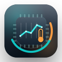
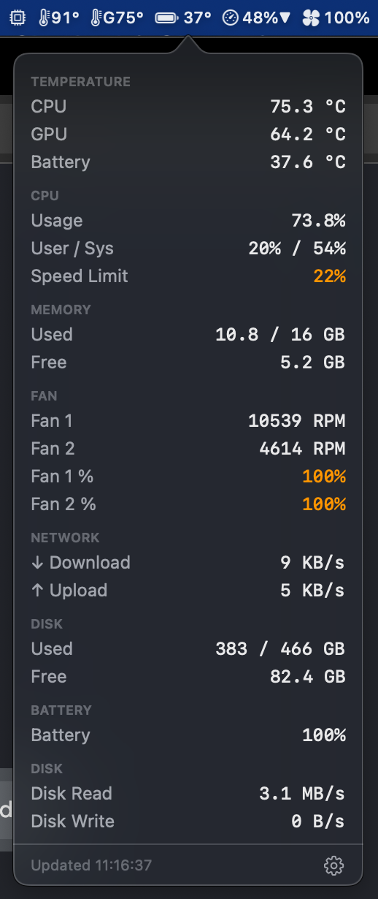
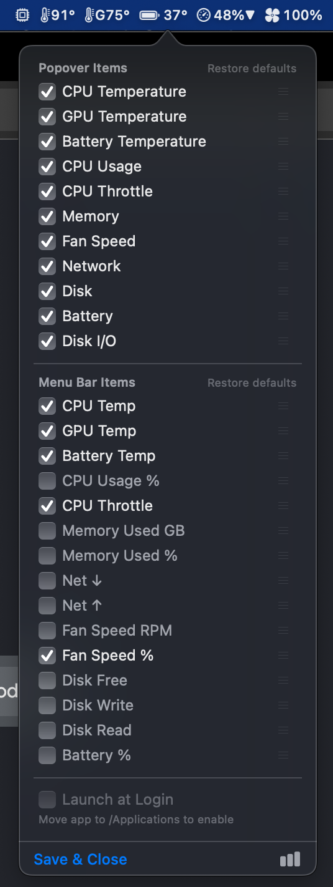

<p align="center">
  
</p>

<h1 align="center">MacStat</h1>

<p align="center">
  A no-frills macOS menubar monitor. Live stats, zero clutter.
</p>

<p align="center">
  
</p>

---

## What it shows

Pick exactly what appears in your menubar and popover — everything is toggleable and reorderable.

| | |
|---|---|
| **Temperature** | CPU · GPU · Battery |
| **CPU** | Usage % · Thermal state / speed limit · Low Power Mode |
| **Memory** | Used GB or % |
| **Fan** | RPM or % |
| **Network** | Download · Upload |
| **Disk** | Free space · Read / write speed |
| **Battery** | Charge % · Charging speed (W) |

Settings include three persistent Keep Awake checkboxes:

- **Keep Awake on AC Power** — prevent system sleep while plugged in.
- **Keep Awake on Battery** — prevent idle system sleep on battery (off by default).
- **Keep Awake with Lid Closed** — also prevent lid-close sleep on the selected power sources (off by default). For example, select AC Power and Lid Closed to keep running with the lid closed only while plugged in; also select Battery to allow it when unplugged.

The display can still turn off. Lid-closed mode uses IOKit's undocumented `kPMSetClamshellSleepState` interface ([Apple's implementation](https://github.com/apple-oss-distributions/xnu/blob/main/iokit/Kernel/RootDomainUserClient.cpp)), without administrator privileges or changing `pmset` preferences. A helper restores lid-close sleep when the option is disabled or MacStat exits, including an unexpected exit of the main app. If macOS rejects the interface, MacStat unchecks the lid option and shows an error. Physical lid behavior may vary with hardware and macOS versions.

The interface follows your macOS language preference and supports English, Simplified Chinese, and Traditional Chinese.

## Screenshots

<p align="center">
  
  &nbsp;&nbsp;
  
</p>

## Install

1. Download `MacStat.dmg` from [Releases](https://github.com/azlarsin/mac-stat/releases)
2. Open the DMG and drag **MacStat** to `/Applications`
3. Launch — it lives quietly in your menubar

> Installing to `/Applications` is required for **Launch at Login**.

**Requirements:** macOS 13 Ventura or later · Intel & Apple Silicon

## Command line / SSH

1. Open MacStat's **Settings** from the menu bar.
2. Click **Install Command Line Tool** at the bottom of the panel
   (**安装命令行工具** / **安裝命令列工具** in Chinese).
3. The panel shows whether installation succeeded. The command is installed at
   `~/.local/bin/mac-stat` without administrator privileges.

You can also install from Terminal:

```bash
/Applications/MacStat.app/Contents/MacOS/MacStat install-cli
```

This installs `mac-stat` into `~/.local/bin`. Add that directory to your shell's `PATH`
if needed (`export PATH="$HOME/.local/bin:$PATH"` in `~/.zshrc`). You can also pass a
different directory to `install-cli`, or call the app executable directly with the
same commands. Re-run the installer or click the button again if you move the app.
Reinstalling updates MacStat's own launcher; an unrelated existing `mac-stat`
command is left untouched and an error is shown.

```bash
mac-stat settings list
mac-stat settings get keepAwakeOnACPower
mac-stat settings set keepAwakeOnACPower on
mac-stat settings set keepAwakeOnBattery off
mac-stat settings set keepAwakeWithLidClosed on
mac-stat settings list --json

# From another machine; use the same account that runs MacStat.
ssh your-mac '~/.local/bin/mac-stat settings list --json'
ssh your-mac '~/.local/bin/mac-stat settings set keepAwakeOnACPower on'
ssh your-mac '~/.local/bin/mac-stat settings set keepAwakeWithLidClosed on'
```

MacStat must be running in that user's logged-in desktop session. If necessary,
start it with `open -a MacStat`. The desktop can stay locked while commands run.
Use `~/.local/bin/mac-stat` over SSH so the remote shell does not need a `PATH`
change. The CLI connects through a local socket; it works
over SSH without opening a network port or requiring `sudo`. Changes take effect
through the same settings logic as the UI and are saved for future launches.
The CLI exits with `0` on success and `1` on failure, with errors on stderr.
`--json` returns an object mapping setting names to boolean, array, or string values.

Boolean values accept `true`/`false`, `on`/`off`, or `1`/`0`. Available settings:

| Keys | Values |
|---|---|
| `keepAwakeOnACPower`, `keepAwakeOnBattery`, `keepAwakeWithLidClosed` | Boolean; power source choices still govern whether Keep Awake is active |
| `launchAtLogin` | Boolean; macOS may require approval in System Settings → General → Login Items |
| `showCPUTemp`, `showGPUTemp`, `showBatteryTemp`, `showCPUUsage`, `showThrottle`, `showMemory`, `showFan`, `showNetwork`, `showDisk`, `showDiskIO`, `showBattery`, `showBatteryChargeRate` | Boolean; controls popover visibility |
| `menuBarEnabled` | Comma-separated item IDs, `all`, or `none` |
| `menuBarOrder`, `popoverOrder` | Comma-separated item IDs; omitted items follow in their default order; `''` restores the default order |
| `keepAwakeError` | Read-only string containing the latest reported lid-mode error, or an empty string |

Use `settings get menuBarOrder` or `settings get popoverOrder` to see the valid IDs.
For example:

```bash
mac-stat settings set menuBarEnabled cpuTemp,cpuThrottle,batteryPct
mac-stat settings set menuBarOrder batteryPct,cpuTemp
mac-stat settings set popoverOrder battery,memory,cpuTemp
```

`get` and `set` also accept a final `--json`. Keep Awake values describe the saved
choices; hardware-dependent lid-mode failures may be reported asynchronously in
`keepAwakeError`. Run `mac-stat --help` for usage.

## Build from source

```bash
xcodebuild \
  -project MacStat/MacStat.xcodeproj \
  -scheme MacStat \
  -configuration Debug \
  build \
  CODE_SIGN_IDENTITY="" \
  CODE_SIGNING_REQUIRED=NO \
  CODE_SIGNING_ALLOWED=NO
```

Run the CLI tests with `bash Tests/run-cli-tests.sh`. They use isolated preferences
and sockets and disable system service changes, so they do not change sleep policy
or login items on the development machine.

## Author

[azlar](https://github.com/azlarsin)
